<div align="center">

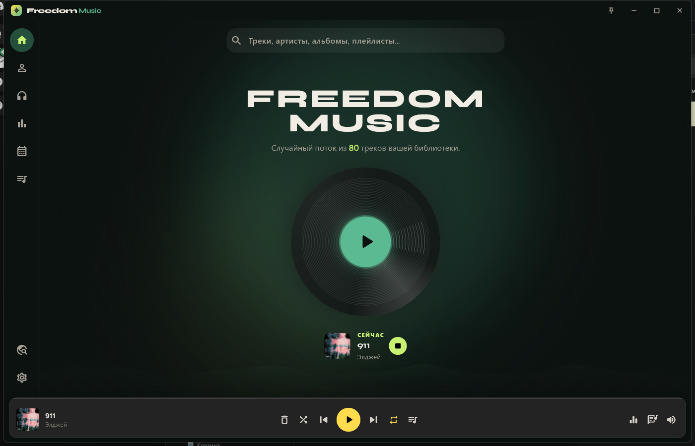

<br/><br/>

# FREEDOM MUSIC

**Локальный плеер.** Музыка на вашем диске — метаданные в файлах.

<br/>

<a href="https://github.com/TheSadFreedom/freedom-music/releases/latest">
  
</a>

<br/><br/>


<br/><br/>

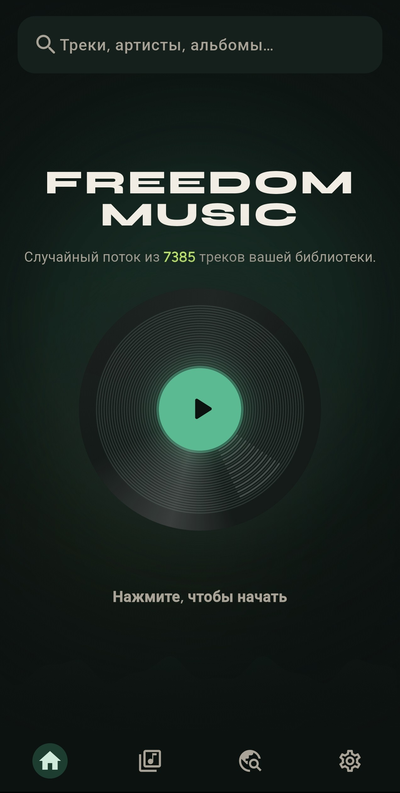
&nbsp;&nbsp;
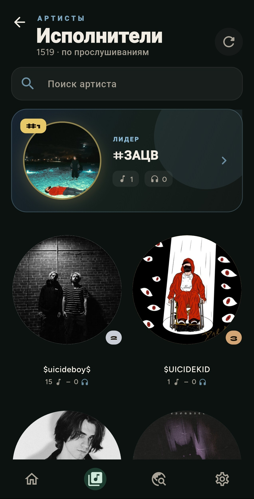
&nbsp;&nbsp;
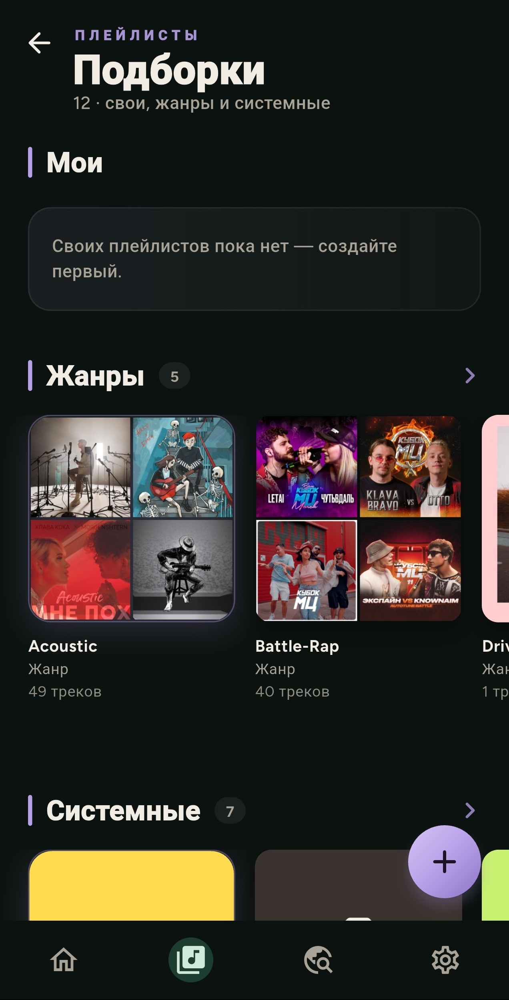

</div>

---

## Идея

Без облака и подписок. Положите MP3 в папку — Freedom Music читает теги, пишет правки обратно в файлы и считает прослушивания локально.

Один вкус на двух платформах. Экспорт переносит плейлисты, историю и фото — сами треки остаются у вас.

---

## Галерея

<div align="center">

| | |
|:---:|:---:|
| 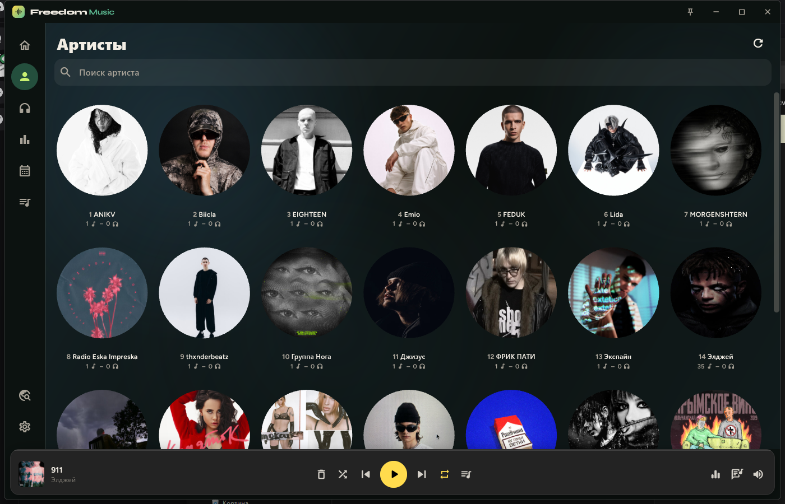<br/><sub>Артисты · Windows</sub> | <br/><sub>Артисты · Android</sub> |
| 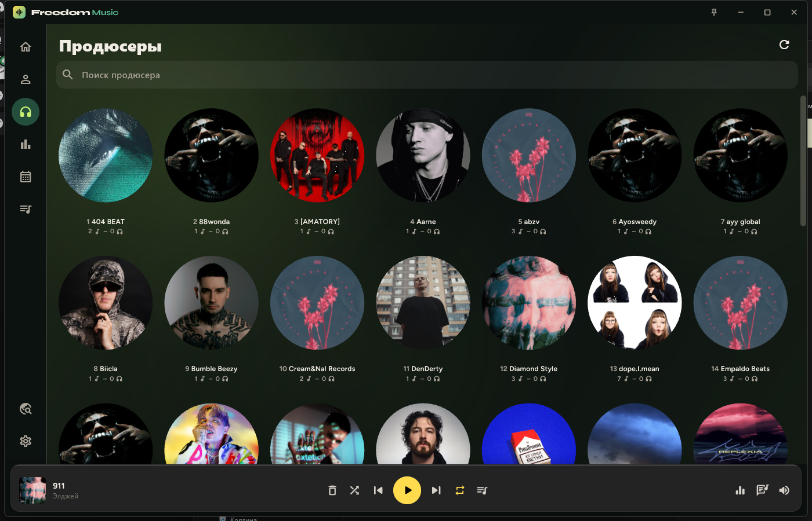<br/><sub>Продюсеры · Windows</sub> | 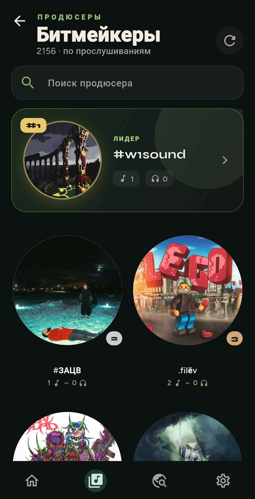<br/><sub>Продюсеры · Android</sub> |
| 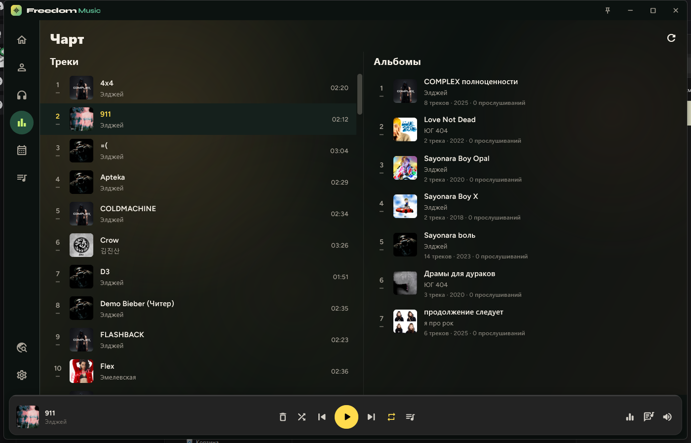<br/><sub>Чарт · Windows</sub> | 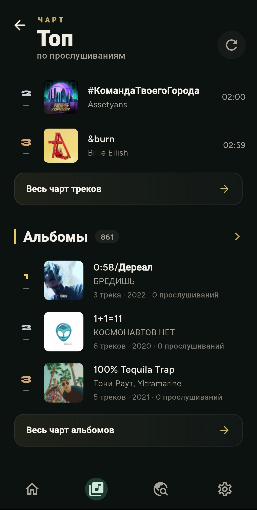<br/><sub>Чарт · Android</sub> |
| 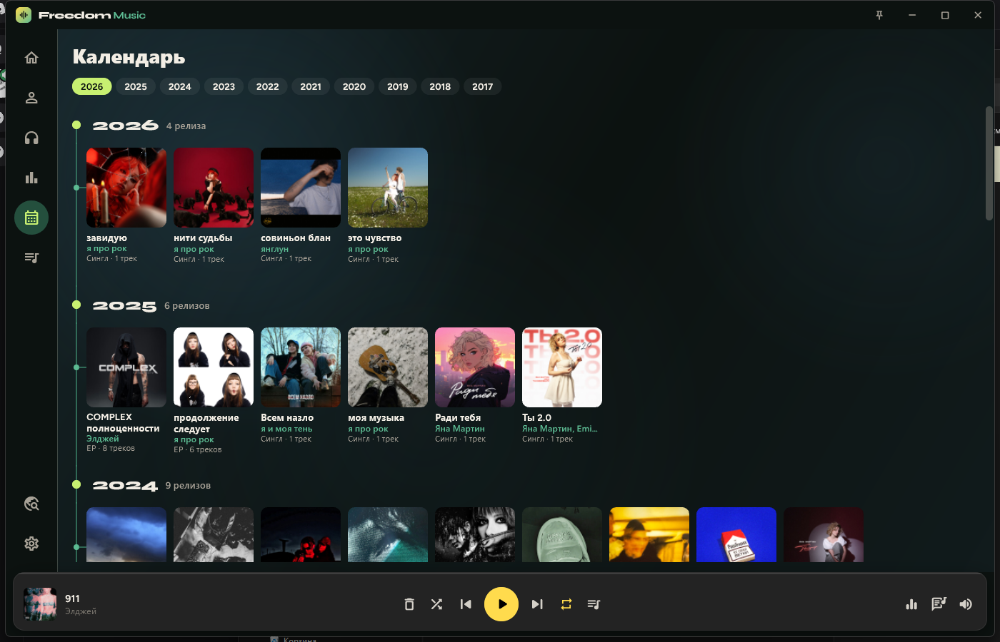<br/><sub>Календарь · Windows</sub> | 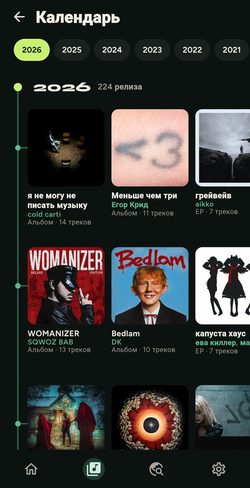<br/><sub>Календарь · Android</sub> |
| 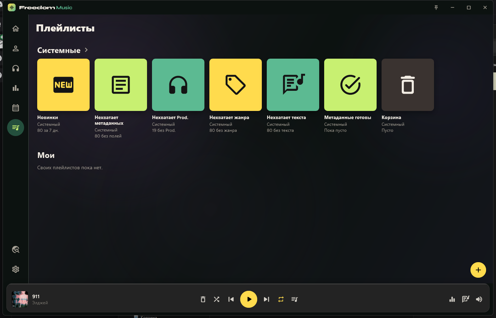<br/><sub>Плейлисты · Windows</sub> | <br/><sub>Плейлисты · Android</sub> |

</div>

---

## Что умеет

| | |
|---|---|
| **Библиотека** | Артисты, продюсеры, чарт, календарь релизов |
| **Плейлисты** | Свои и системные: новинки, метаданные, корзина |
| **Плеер** | Очередь, EQ, тексты с таймкодами, редактор тегов |
| **Синхронизация** | Экспорт / импорт между Windows и Android |

---

## Установка

<details open>
<summary><strong>Windows</strong></summary>

<br/>

1. Скачайте `FreedomMusic-*-windows-x64.zip` из [релизов](https://github.com/TheSadFreedom/freedom-music/releases/latest)
2. Распакуйте **всю** папку — не один `.exe`
3. Запустите `Freedom Music.exe`
4. Положите MP3 в папку `music` рядом с программой
5. В настройках — **Поиск новых** или **Сканировать папку music**

Нужны Windows 10/11 ×64 и [VC++ Redistributable](https://learn.microsoft.com/cpp/windows/latest-supported-vc-redist).

</details>

<details open>
<summary><strong>Android</strong></summary>

<br/>

1. Скачайте `FreedomMusic-*-android.apk` из [релизов](https://github.com/TheSadFreedom/freedom-music/releases/latest)
2. Разрешите установку из этого файла
3. Дайте доступ к музыке и отсканируйте библиотеку

</details>

---

## Данные

| В файлах | В приложении | В экспорте |
|---|---|---|
| Теги, обложки, тексты | Плейлисты, прослушивания, фото | Плейлисты, история, фото, объединения, настройки |
| | | **Не входит:** MP3, пути, EQ, очередь |

На другой платформе сначала просканируйте те же треки — связи идут по артисту и названию.

---

<details>
<summary><strong>Для разработчиков</strong></summary>

<br/>

```
freedom-music/
├── apps/windows
├── apps/android
└── docs/screenshots
```

```bash
cd apps/windows && flutter pub get && flutter build windows --release
cd apps/android && flutter pub get && flutter build apk --release
```

Android release-подпись: локальные `key.properties` и keystore — не в git.

</details>

<br/>

<div align="center">

<sub>Сделано для тех, кто хранит музыку у себя.</sub>

</div>
